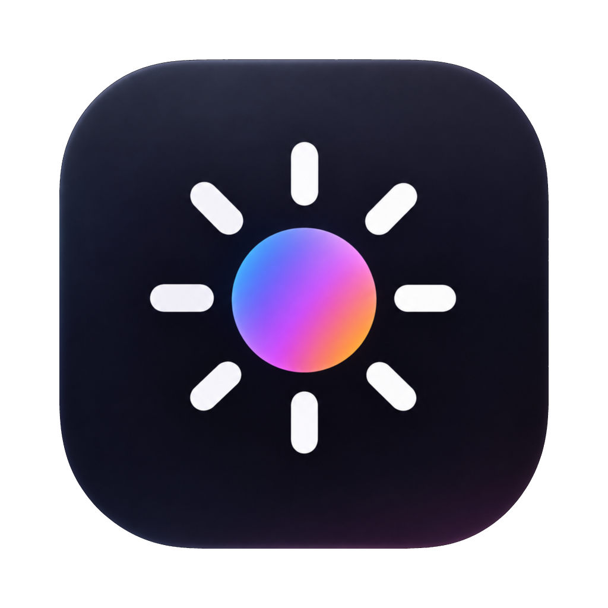
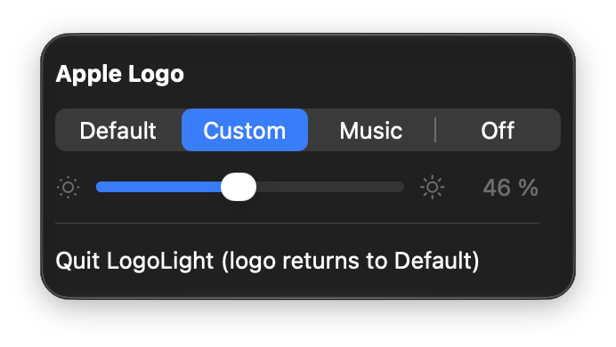

<p align="center">
  
</p>

<h1 align="center">LogoLight</h1>

<p align="center">Menu bar control for the glowing Apple logo on the OLED MacBook Pro.</p>

<p align="center">
  <a href="https://github.com/jaxmef/LogoLight/releases/latest"></a>
  <a href="https://github.com/jaxmef/LogoLight/actions/workflows/ci.yml"></a>
</p>

> **Disclaimer:** LogoLight uses undocumented macOS interfaces. A macOS update may break it. Use at your own risk.

<p align="center">
  
</p>

## Modes

- **Default**: macOS controls the logo, as without the app.
- **Custom**: fixed brightness, 0–100 %. 0 % is the dimmest glow.
- **Music**: pulses with whatever your Mac plays. The slider sets the peak.
- **Off**: the logo stays dark.

LogoLight only controls the logo while it's running. Quitting hands it back to macOS. In Custom and Music, the logo
turns off when you close the lid or the Mac sleeps.

## Requirements

MacBook Pro M5 Pro with OLED display, macOS 27.2. That's the only tested model. On anything that doesn't match it,
LogoLight shows a message and leaves the logo alone. No admin rights needed.

## Install

1. Download the `.dmg` from [Releases](../../releases) and drag LogoLight to Applications.
2. Open it. macOS blocks the first launch because the app isn't notarized: go to System Settings › Privacy & Security
   and click **Open Anyway**.

To start it at login, add it in System Settings › General › Login Items.

**Music** needs permission to record system audio. macOS asks the first time; if you missed it, turn LogoLight on in
System Settings › Privacy & Security › Screen & System Audio Recording › System Audio Recording Only. Audio is only
measured for loudness, never recorded.

## Troubleshooting

- **Logo dark after a restart**: LogoLight didn't quit cleanly (crash or force quit). Open it and choose Default.
- **Music doesn't react**: check the audio permission above.

## Uninstall

Quit LogoLight, delete it, and remove it from Login Items if you added it. Optionally:
`defaults delete io.github.jaxmef.LogoLight`, and turn off its audio permission.

## Use as a Swift library

The logo control is also a library, `LogoCore`, that you can add to your own project with Swift Package Manager.
See [Sources/LogoCore/README.md](Sources/LogoCore/README.md).

## Build from source

Needs the Xcode Command Line Tools (`xcode-select --install`) or Xcode, with the macOS 27.2 SDK.

```sh
git clone https://github.com/jaxmef/LogoLight.git
cd LogoLight
./build.sh               # → build/LogoLight.app, build/logoctl
./test.sh                # hardware-free tests
```

Running the app or `logoctl` changes the real logo. `build/logoctl default` always hands it back to macOS.

### logoctl

```sh
build/logoctl status             # read-only
build/logoctl custom 40          # 0-100, same scale as the app
build/logoctl off
build/logoctl default
build/logoctl music 30 --max 50  # follow system audio for 30 s, then restore Default
build/logoctl music 10 --test    # synthetic beat, no audio permission needed
```

`custom` and `off` stay in effect until `default`, also across restarts.

### Releases

```sh
SIGN_IDENTITY="LogoLight Code Signing" ./release.sh 1.0.0   # → dist/
```

Sign every release with the same self-signed certificate (Keychain Access › Certificate Assistant › Create a
Certificate, type Code Signing). Otherwise users have to grant the audio permission again after each update.

## Safety

Brightness is capped at what macOS itself uses (about 1000 nits), with the same PWM settings. LogoLight writes nothing
but the logo's own brightness settings: no NVRAM, no SMC.

## License

MIT, see [LICENSE](LICENSE). The icon was generated with ChatGPT and is covered by the same license.

Apple and the Apple logo are trademarks of Apple Inc. LogoLight is not affiliated with Apple.
